# 🇮🇱 ישראל – בלוקים ישראליים למיקרוביט

הרחבה ל-[MakeCode](https://makecode.microbit.org) עם בלוקים בכחול-לבן: מגן דוד וסמלים, תמונות נגללות,
טקסט בעברית על מסך הלדים, "התקווה" ושירי חגים, אנימציות ומורס עברי.

## איך מוסיפים את ההרחבה

1. פתחו פרויקט ב-https://makecode.microbit.org
2. לחצו על ⚙️ ← **הרחבות** (Extensions)
3. הדביקו את הכתובת **https://github.com/nadaval56/israel-microbit** בשורת החיפוש ובחרו בהרחבה
4. בארגז הכלים תופיע קטגוריה כחולה חדשה בשם **ישראל** (Israel)

> כשממשק MakeCode מוגדר לעברית, שמות הבלוקים מופיעים בעברית. בממשק באנגלית הם מופיעים באנגלית.
> התמונות בעמוד הזה צולמו מ-MakeCode בעברית. מתחת לכל תמונה אפשר לפתוח את הקוד ולהדביק אותו בעורך ה-JavaScript.

## הבלוקים

### עברית על מסך הלדים
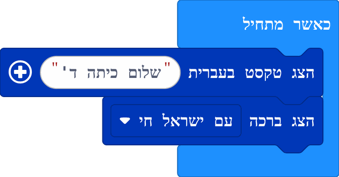

<details><summary>הצג קוד</summary>

```blocks
israel.showHebrew("שלום כיתה ד'")
israel.showGreeting(HebrewGreeting.AmIsraelChai)
```

</details>

למיקרוביט אין גופן עברי, ולכן ההרחבה כוללת גופן עברי משלה בגודל 5×5 – כל 22 האותיות וגם האותיות הסופיות.
הטקסט נגלל בכיוון הקריאה העברי: הוא נכנס מצד שמאל וזז ימינה, כך שהאות הראשונה מופיעה ראשונה.
נתמכים גם ספרות (שנשארות משמאל לימין, למשל "2026"), רווח, וסימני הפיסוק `! ? . , - : ' "`. ניקוד ותווים אחרים מדולגים.
בלחיצה על "+" בבלוק אפשר לשנות את מהירות הגלילה.

ברכות מוכנות: שלום, ישראל, עם ישראל חי, חג עצמאות שמח, חג שמח, שבת שלום, שנה טובה, ירושלים, מזל טוב, תודה רבה.

### סמלים
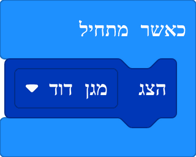

<details><summary>הצג קוד</summary>

```blocks
israel.showSymbol(IsraelSymbol.StarOfDavid)
```

</details>

סמלים זמינים: מגן דוד, סביבון, ספר תורה.
הסמלים משתמשים בעוצמות אור שונות: הצורה עצמה בהירה, ופרטי רקע עמומים יותר.
הבלוק `תמונה של` מחזיר את הסמל כתמונה, לשימוש עם בלוקי התמונות של MakeCode.

### אנימציות ותמונות נגללות
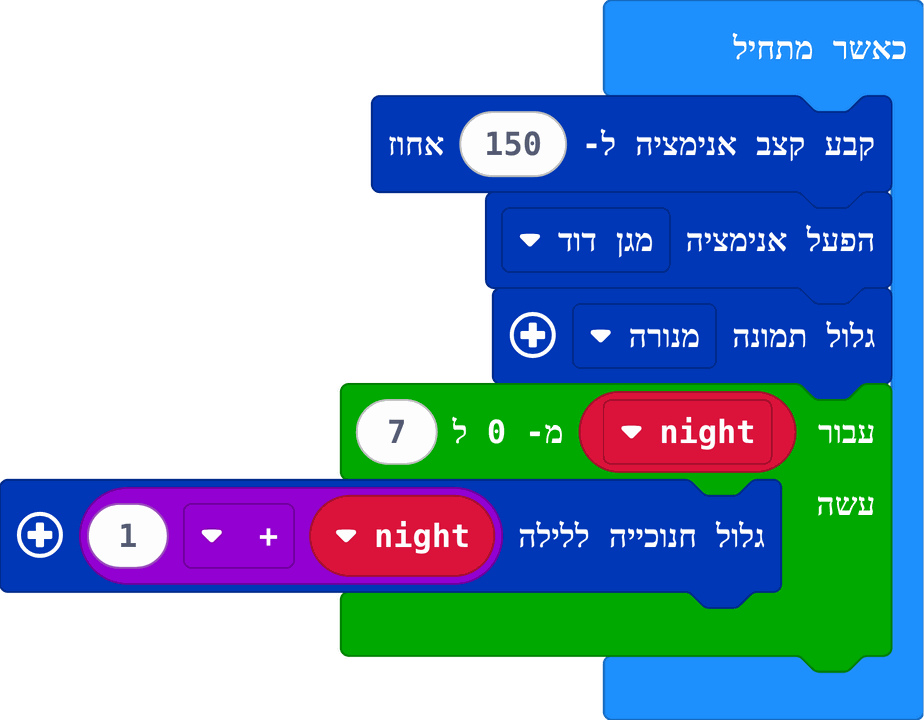

<details><summary>הצג קוד</summary>

```blocks
israel.setAnimationSpeed(150)
israel.playAnimation(IsraelAnimation.StarOfDavid)
israel.scrollPicture(IsraelPicture.Menorah)
for (let night = 0; night <= 7; night++) {
    israel.scrollHanukkiah(night + 1)
}
```

</details>

* **קבע קצב אנימציה ל- ... אחוז** – משפיע על כל האנימציות שבאות אחריו: 100 רגיל, 50 חצי מהירות, 200 כפול
* **הפעל אנימציה [מגן דוד]** – הכוכב נבנה נורה אחר נורה, אור עם זנב רץ סביבו, הוא מנצנץ ובסוף פועם
* **הפעל אנימציה [זיקוקי יום העצמאות]** – זיקוקים שמתפוצצים ונגמרים במגן דוד
* **גלול תמונה** – תמונה רחבה שנגללת על המסך: חנוכייה (8 נרות ושמש), מנורת 7 קנים, דגל ישראל, ירושלים
* **גלול חנוכייה ללילה...** – חנוכייה נגללת שבה דולקים רק הנרות של אותו לילה, מימין לשמאל
* **הדלק נרות חנוכה ללילה...** – השמש נדלק, אחריו הנרות אחד אחד, עם להבות מהבהבות

בדוגמה, הלולאה גוללת את כל שמונת לילות החנוכה ברצף (הלולאה סופרת מ-0 עד 7, ולכן הלילה הוא המספר ועוד 1).

### מוזיקה
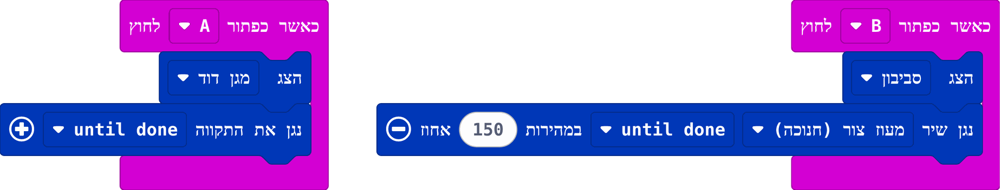

<details><summary>הצג קוד</summary>

```blocks
input.onButtonPressed(Button.A, function () {
    israel.showSymbol(IsraelSymbol.StarOfDavid)
    israel.playHatikvah()
})
input.onButtonPressed(Button.B, function () {
    israel.showSymbol(IsraelSymbol.Dreidel)
    israel.playSong(IsraeliSong.MaozTzur, music.PlaybackMode.UntilDone, 150)
})
```

</details>

* **נגן את התקווה** – ההמנון המלא
* **נגן שיר** – בוחרים שיר מהרשימה:

| שיר | מתי |
|---|---|
| עם ישראל חי (שלמה קרליבך) | כל השנה |
| סביבון | חנוכה |
| מעוז צור | חנוכה |
| חג פורים | פורים |
| ושמחת בחגך | סוכות |
| ושאבתם מים | סוכות |
| דיינו | פסח |
| בר יוחאי | ל"ג בעומר |
| סלינו על כתפינו | שבועות |
| שירת העשבים (נעמי שמר) | כל השנה |
| אלי אלי – הליכה לקיסריה | יום הזיכרון |

המנגינות מתנגנות ברמקול של המיקרוביט, או ברמקול שמחובר לפין 0. בין התווים יש הפסקה קצרה, כך שתווים זהים ברצף נשמעים בנפרד.
כל שיר מתנגן בקצב הטבעי שלו. בלחיצה על "+" בבלוק אפשר לבחור מהירות באחוזים: 100 רגיל, 50 חצי מהירות, 200 כפול.
בלוק "קבע קצב" (tempo) של MakeCode משנה את המהירות של כל השירים יחד: 120 הוא הקצב הרגיל.

**מנגנים ומציגים בו זמנית.** כמו בבלוקי המוזיקה של MakeCode, בוחרים בבלוק איך לנגן:
* **עד הסוף** – התוכנית מחכה שהשיר ייגמר, ורק אז ממשיכה לבלוק הבא.
* **ברקע** – השיר מתחיל, והתוכנית ממשיכה מיד. כך אפשר להציג טקסט או אנימציה בזמן שהשיר מתנגן.
* **ברקע בלולאה** – השיר חוזר שוב ושוב, עד ש"עצור את כל הצלילים" או עד ששיר אחר מתחיל.
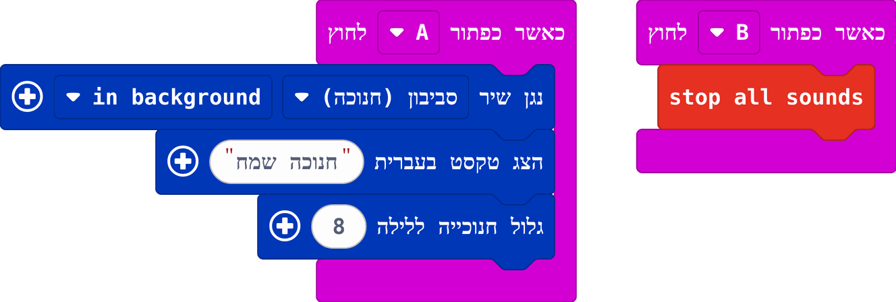

<details><summary>הצג קוד</summary>

```blocks
input.onButtonPressed(Button.A, function () {
    israel.playSong(IsraeliSong.Sevivon, music.PlaybackMode.InBackground)
    israel.showHebrew("חנוכה שמח")
    israel.scrollHanukkiah(8)
})
input.onButtonPressed(Button.B, function () {
    music.stopAllSounds()
})
```

</details>

כשמתחיל שיר חדש, השיר הקודם נעצר.

המנגינות שמורות בקובץ `songs.ts`, שנוצר מהגרסה הקריאה שלהן ב-`tools/make_songs.py` (שתי אותיות לכל תו, כדי שהכל ייכנס גם במיקרוביט V1).

### מורס עברי
לכל אות עברית יש קוד מורס משלה (א `·–`, ב `–···`, ש `···`, ת `–` ...). האותיות הסופיות מקבלות את הקוד של האות הרגילה.
נקודה היא צפצוף קצר, קו ארוך פי שלושה, ויש הפסקות קבועות בין אותיות ובין מילים.

#### 1. המיקרוביט כמצפין
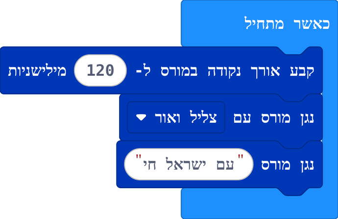

<details><summary>הצג קוד</summary>

```blocks
israel.setMorseSpeed(120)
israel.setMorseOutput(MorseOutput.SoundAndLight)
israel.playMorse("עם ישראל חי")
```

</details>

* **נגן מורס** – טקסט חופשי (מילה, כמה מילים או משפט שלם) לא מוצג; במקומו יוצאים צפצופים, ובמסך מהבהבת נקודה (`+` קטן) או קו.
* **קבע אורך נקודה** – מהירות המורס. **נגן מורס עם** – צליל, אור או שניהם.
* **קוד מורס של** – מחזיר מחרוזת כמו `... .-.. . --` (רווח בין אותיות, `/` בין מילים).

#### 2. שליחה ברדיו
שני מיקרוביטים באותה קבוצת רדיו, עם ההרחבה בשניהם. בסימולטור של MakeCode מופיעים שני לוחות אוטומטית כשמשתמשים ברדיו.

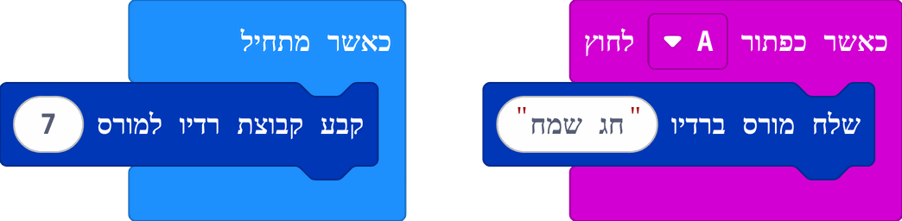

<details><summary>הצג קוד</summary>

```blocks
israel.setMorseRadioGroup(7)
input.onButtonPressed(Button.A, function () {
    israel.sendMorse("חג שמח")
})
```

</details>

"שלח מורס ברדיו" שולח את ההודעה אות אחר אות, סימן אחר סימן, בקצב המורס. השולח רק מהבהב.

לבניית טלגרף משלכם יש ארבעה בלוקים, שכל אחד מהם שולח סימן ברדיו ומנגן אותו גם כאן:
* **מורס: שלח נקודה**, **מורס: שלח קו**, **מורס: סיים אות**, **מורס: סיים מילה**
* **האות האחרונה שנשלחה במורס** – האות שהוקשה, אם רוצים להציג אותה

מחליטים לבד מה מפעיל כל סימן: כפתורים, לוגו המגע, ניעור, פין, לולאות ועוד. למשל:
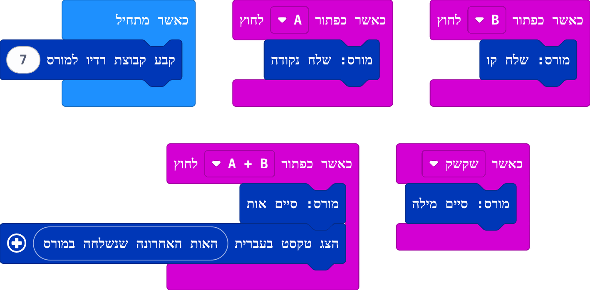

<details><summary>הצג קוד</summary>

```blocks
israel.setMorseRadioGroup(7)
input.onButtonPressed(Button.A, function () {
    israel.sendDot()
})
input.onButtonPressed(Button.B, function () {
    israel.sendDash()
})
input.onButtonPressed(Button.AB, function () {
    israel.endLetter()
    israel.showHebrew(israel.lastLetterSent())
})
input.onGesture(Gesture.Shake, function () {
    israel.endWord()
})
```

</details>


#### 3. קליטה ברדיו
המקבל מחליט מה לעשות עם כל אות שמגיע:
* **כשמתקבל אות מורס (signal)** – אירוע עם המשתנה `signal`: `.` נקודה, `-` קו, רווח לסוף אות, `/` לסוף מילה
* **הצג אות מורס בנוריות** – `+` קטן לנקודה, פס לקו. התוכנית ממשיכה לרוץ בזמן ההצגה, כך שאפשר לשים אחריו צליל והם יופיעו יחד
* **השמע אות מורס** – צפצוף קצר לנקודה, ארוך לקו
* **מורס [נקודה / קו / סוף אות / סוף מילה]** – להשוואה עם האות שהתקבל

חידה – רק מצפצפים ומהבהבים, והמאזינים מפענחים בעצמם:
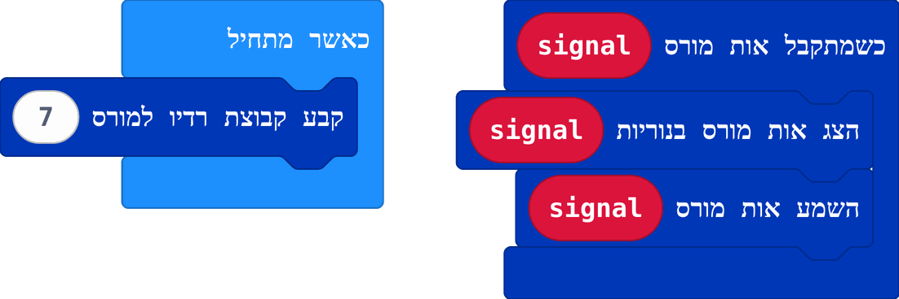

<details><summary>הצג קוד</summary>

```blocks
israel.setMorseRadioGroup(7)
israel.onMorseReceived(function (signal) {
    israel.showMorseSignal(signal)
    israel.playMorseSignal(signal)
})
```

</details>


> אפשר לשלב את בלוקי המורס עם בלוקי הרדיו הרגילים של MakeCode באותה תוכנית. ההסבר בפרק "רדיו: טקסט בעברית ואנימציות".

#### 4. בונים מפענח אוטומטי, צעד אחר צעד
המקבל יכול לפענח את ההודעה לבד. הרעיון: בכל פעם שמגיעה נקודה או קו מוסיפים אותם לסוף משתנה טקסט, וכשמגיע "סוף אות" בודקים לאיזו אות זה מתאים.

**צעד 1 – אוספים את הסימנים.** יוצרים משתנה `code` (בקטגוריית משתנים) שמתחיל כטקסט ריק. בכל פעם שמגיעה נקודה או קו, מצרפים אותם לסוף המשתנה בעזרת הבלוק **"צרף"** מקטגוריית טקסט. כדי לראות מה נאסף, מציגים את המשתנה:
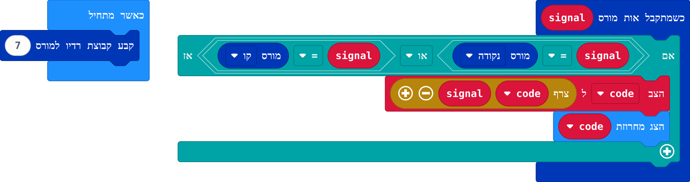

<details><summary>הצג קוד</summary>

```blocks
let code = ""
israel.setMorseRadioGroup(7)
israel.onMorseReceived(function (signal) {
    if (signal == israel.morseSignal(MorseSignal.Dot) || signal == israel.morseSignal(MorseSignal.Dash)) {
        code = "" + code + signal
        basic.showString(code)
    }
})
```

</details>

שולחים מהמיקרוביט השני את האות ש, ורואים על המסך `.`, אחר כך `..` ובסוף `...`.

**צעד 2 – מזהים אות אחת.** כשמגיע "סוף אות", משווים את מה שנאסף לבלוק **קוד מורס של "ש"**. אם הם שווים, זו האות ש. אחרי הבדיקה מאפסים את המשתנה, כדי שהאות הבאה תתחיל מהתחלה:
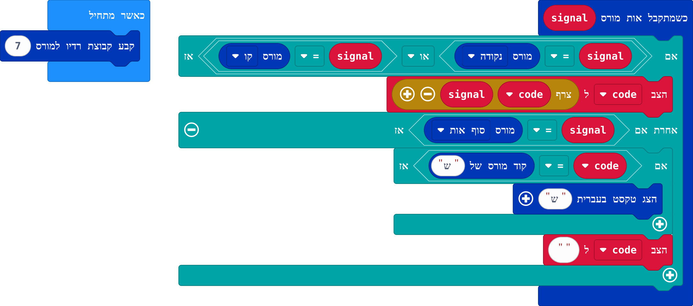

<details><summary>הצג קוד</summary>

```blocks
let code = ""
israel.setMorseRadioGroup(7)
israel.onMorseReceived(function (signal) {
    if (signal == israel.morseSignal(MorseSignal.Dot) || signal == israel.morseSignal(MorseSignal.Dash)) {
        code = "" + code + signal
    } else if (signal == israel.morseSignal(MorseSignal.LetterEnd)) {
        if (code == israel.textToMorse("ש")) {
            israel.showHebrew("ש")
        }
        code = ""
    }
})
```

</details>

זה הטריק של המפענח: לא צריך לזכור את טבלת המורס, כי הבלוק "קוד מורס של" יודע אותה.

**צעד 3 – כל האותיות.** במקום לכתוב "אם" לכל אחת מ-22 האותיות, כותבים את כל האותיות במשתנה טקסט אחד, `alphabet`, ועוברים עליו בלולאה **"עבור index מ-0 ל..."** (קטגוריית לולאות), עד **אורך של alphabet פחות 1**.
בכל סיבוב לוקחים את האות שבמקום `index` בעזרת הבלוק **"תו מ- ... ב- ..."** (קטגוריית טקסט), ובודקים אם קוד המורס שלה שווה למה שנאסף:
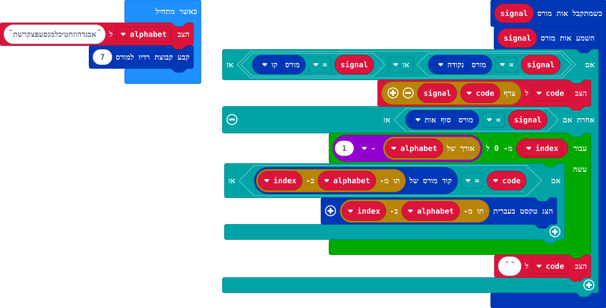

<details><summary>הצג קוד</summary>

```blocks
let code = ""
let alphabet = "אבגדהוזחטיכלמנסעפצקרשת"
israel.setMorseRadioGroup(7)
israel.onMorseReceived(function (signal) {
    israel.playMorseSignal(signal)
    if (signal == israel.morseSignal(MorseSignal.Dot) || signal == israel.morseSignal(MorseSignal.Dash)) {
        code = "" + code + signal
    } else if (signal == israel.morseSignal(MorseSignal.LetterEnd)) {
        for (let index = 0; index <= alphabet.length - 1; index++) {
            if (code == israel.textToMorse(alphabet.charAt(index))) {
                israel.showHebrew(alphabet.charAt(index))
            }
        }
        code = ""
    }
})
```

</details>


**בונוס – מילה שלמה.** מוסיפים משתנה `word`. כל אות שזוהתה מצטרפת לסוף המילה, וכשמגיע "סוף מילה" מציגים את כל המילה ומתחילים מילה חדשה:
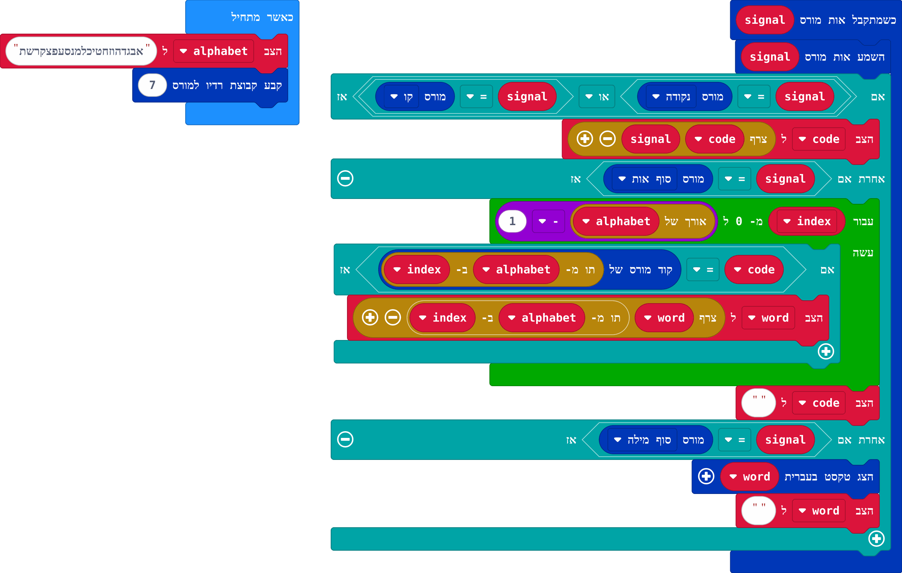

<details><summary>הצג קוד</summary>

```blocks
let code = ""
let word = ""
let alphabet = "אבגדהוזחטיכלמנסעפצקרשת"
israel.setMorseRadioGroup(7)
israel.onMorseReceived(function (signal) {
    israel.playMorseSignal(signal)
    if (signal == israel.morseSignal(MorseSignal.Dot) || signal == israel.morseSignal(MorseSignal.Dash)) {
        code = "" + code + signal
    } else if (signal == israel.morseSignal(MorseSignal.LetterEnd)) {
        for (let index = 0; index <= alphabet.length - 1; index++) {
            if (code == israel.textToMorse(alphabet.charAt(index))) {
                word = "" + word + alphabet.charAt(index)
            }
        }
        code = ""
    } else if (signal == israel.morseSignal(MorseSignal.WordEnd)) {
        israel.showHebrew(word)
        word = ""
    }
})
```

</details>

"שלח מורס ברדיו" שולח "סוף מילה" בסוף כל מילה, כולל המילה האחרונה בהודעה.

**רעיונות להמשך:**
* להוסיף ל-`alphabet` גם ספרות (0–9).
* להציג "?" כשהקוד לא מתאים לאף אות.
* לספור כמה אותיות פוענחו נכון במשחק בין שתי קבוצות.

### רדיו: טקסט בעברית ואנימציות
מיקרוביט אחד שולח, וכל המיקרוביטים באותה קבוצת רדיו מקבלים. בשני הלוחות צריך את ההרחבה.

**טקסט בעברית.** "רדיו שלח טקסט בעברית" שולח מחרוזת שלמה, גם ארוכה. המקבל מציג אותה עם "הצג טקסט בעברית":
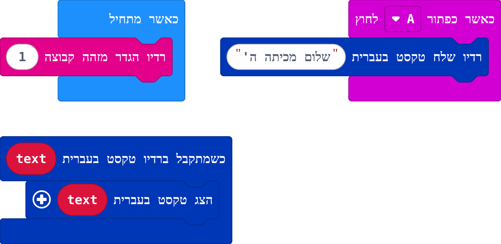

<details><summary>הצג קוד</summary>

```blocks
radio.setGroup(1)
input.onButtonPressed(Button.A, function () {
    israel.sendHebrewText("שלום מכיתה ה'")
})
israel.onHebrewTextReceived(function (text) {
    israel.showHebrew(text)
})
```

</details>

הבלוק "הצג מחרוזת" הרגיל לא יודע להציג עברית, ולכן משתמשים ב"הצג טקסט בעברית".

**אנימציות, סמלים ותמונות.** השולח בוחר מה להפעיל, והמקבל מפעיל את מה שהגיע:
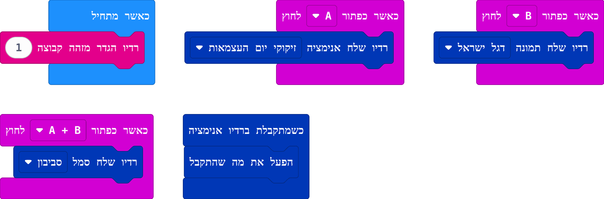

<details><summary>הצג קוד</summary>

```blocks
radio.setGroup(1)
input.onButtonPressed(Button.A, function () {
    israel.sendAnimation(IsraelAnimation.Fireworks)
})
input.onButtonPressed(Button.B, function () {
    israel.sendPicture(IsraelPicture.Flag)
})
input.onButtonPressed(Button.AB, function () {
    israel.sendSymbol(IsraelSymbol.Dreidel)
})
israel.onAnimationReceived(function () {
    israel.playReceived()
})
```

</details>

אפשר להוסיף בתוך האירוע עוד בלוקים, למשל צליל קצר לפני האנימציה או ברכה אחריה.

**למה לא "רדיו שלח מחרוזת" הרגיל?** חבילת רדיו יכולה לשאת עד 19 תווים, ו"הצג מחרוזת" לא מכיר את הגופן העברי.
"רדיו שלח טקסט בעברית" מחלק טקסט ארוך לכמה חבילות, והמקבל מחבר אותן חזרה לפני שהאירוע רץ.
אם חבילה אחת הלכה לאיבוד בדרך, ההודעה כולה לא מוצגת.

> **שילוב עם בלוקי הרדיו הרגילים:** בקטגוריית רדיו של MakeCode יש לכל סוג הודעה (מספר, שם וערך, מחרוזת) אירוע קבלה אחד בלבד,
> ואם משתמשים באותו אירוע פעמיים רק האחרון עובד. בלוקי הרדיו של ההרחבה (וגם בלוקי המורס) שולחים הודעות מסוג buffer,
> ולכן אפשר לשלב אותם באותה תוכנית עם האירועים הרגילים של קבלת מספר, שם וערך או מחרוזת.
> רק את אירוע הקבלה של buffer (בתפריט "עוד" של קטגוריית רדיו) לא כדאי להוסיף לתוכנית כזו.

### כיף
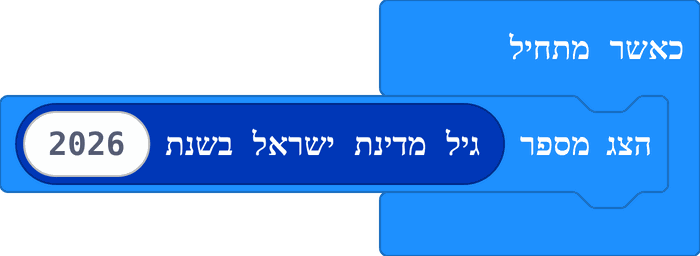

<details><summary>הצג קוד</summary>

```blocks
basic.showNumber(israel.israelAge(2026))
```

</details>

מחזיר את גיל מדינת ישראל בשנה שבוחרים.

## דוגמה: יום העצמאות
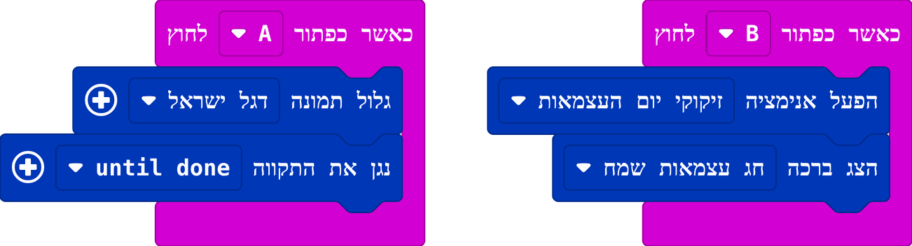

<details><summary>הצג קוד</summary>

```blocks
input.onButtonPressed(Button.A, function () {
    israel.scrollPicture(IsraelPicture.Flag)
    israel.playHatikvah()
})
input.onButtonPressed(Button.B, function () {
    israel.playAnimation(IsraelAnimation.Fireworks)
    israel.showGreeting(HebrewGreeting.HappyIndependenceDay)
})
```

</details>


## הערה על צבעים
הבלוקים צבועים בכחול של דגל ישראל. הלדים של המיקרוביט עצמו אדומים.

---

## English

MakeCode extension for the BBC micro:bit with Israeli blocks: the Star of David and other symbols,
scrolling wide pictures (a hanukkiah, a menorah, the flag, Jerusalem), a built-in 5×5 Hebrew font for
scrolling Hebrew text right-to-left, ready-made Hebrew greetings, Hatikvah and Israeli holiday songs,
animations with an adjustable speed, and Hebrew Morse code: an encoder, radio sending and receiving
blocks, building blocks for your own telegraph, and a step-by-step guide to building a decoder.
Radio blocks send whole Hebrew strings (split into parts when long), animations, symbols and pictures
to other micro:bits. They travel as buffer packets, so the regular radio blocks keep working in the same program.

Add it in MakeCode via **Extensions** and the URL `https://github.com/nadaval56/israel-microbit`.
Block names are translated to Hebrew when the editor language is set to Hebrew.

## License

MIT

## Supported targets

* for PXT/microbit

<script src="https://makecode.com/gh-pages-embed.js"></script><script>makeCodeRender("{{ site.makecode.home_url }}", "{{ site.github.owner_name }}/{{ site.github.repository_name }}");</script>
